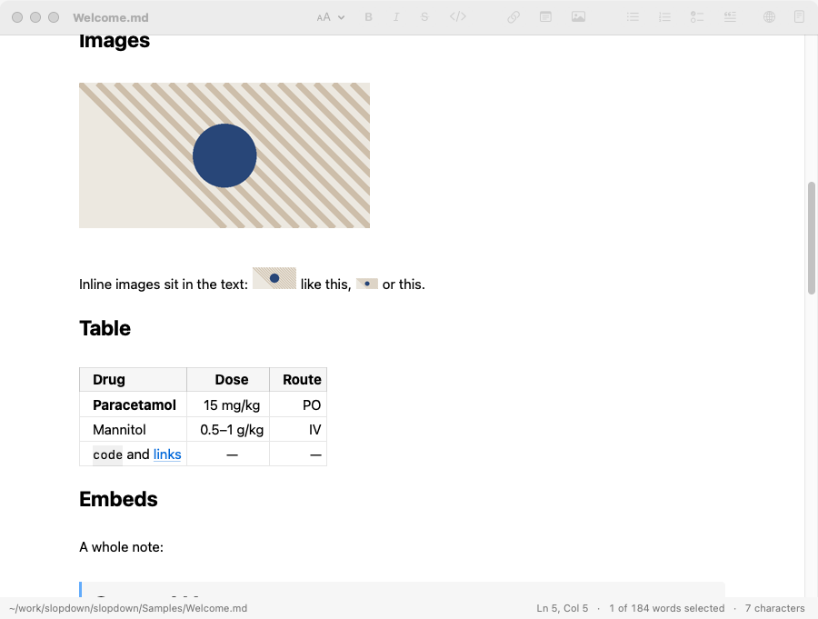
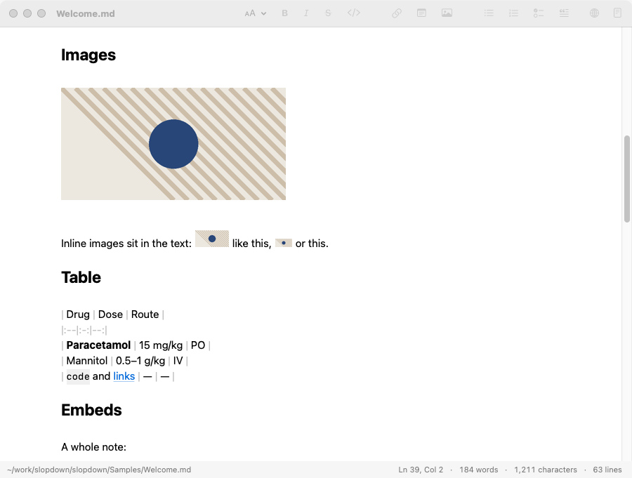
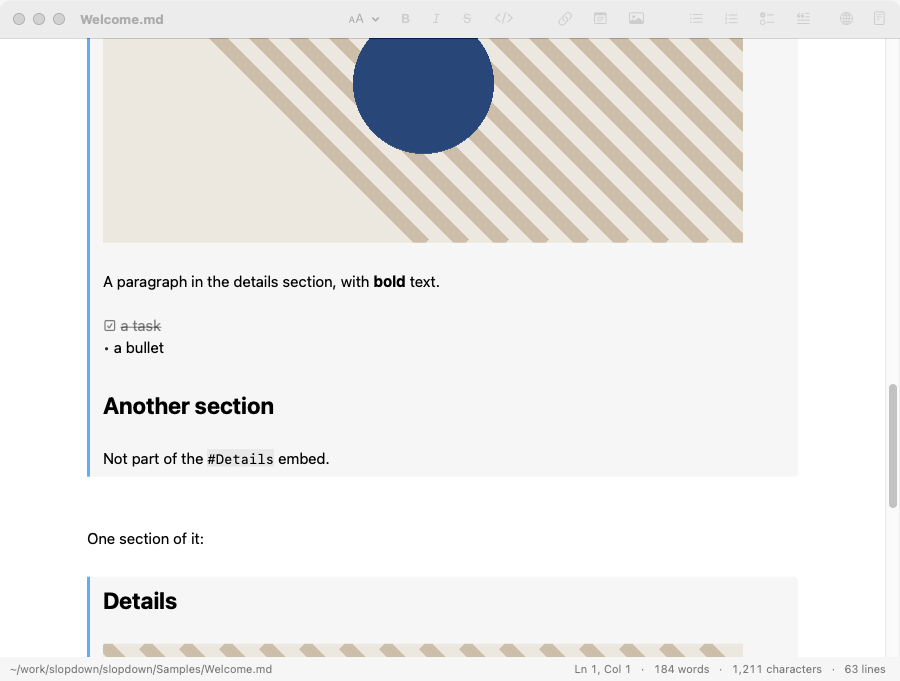
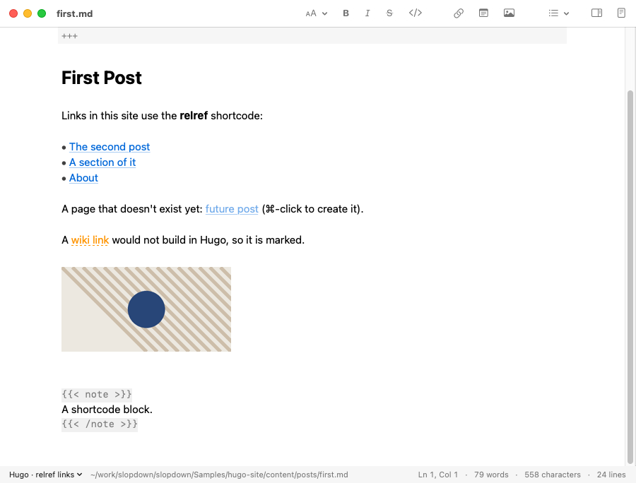
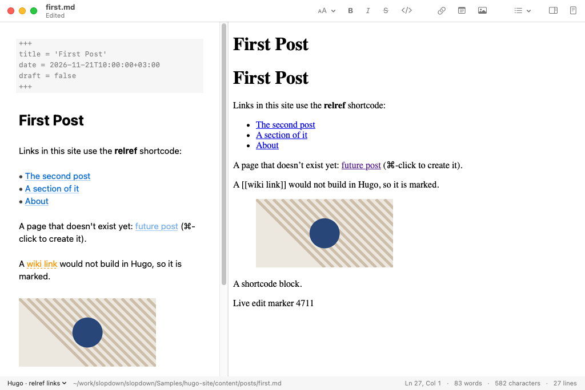

# Slopdown

A small, native macOS markdown editor with Obsidian-style live preview.

> [!WARNING]
> **Vibe-coded.** This app was written by an AI (Claude), not by a human programmer.
> Its owner directs and reviews it but did not write the code. Use at your own risk
> and keep backups of your notes. The same notice in other languages is below; the app
> shows it in your language in **Slopdown → About Slopdown**.

<details>
<summary>🌐 Vibe-coded notice in other languages</summary>

| | |
|---|---|
| **English** | This app is vibe-coded: it was written by an AI (Claude), not by a human programmer. Its owner directs and reviews it but did not write the code. Use it at your own risk and keep backups of your notes. |
| **Türkçe** | Bu uygulama vibe-coded'dur: kodunu bir insan programcı değil, bir yapay zekâ (Claude) yazdı. Sahibi yönlendiriyor ve gözden geçiriyor ama kodu kendisi yazmadı. Kullanım sorumluluğu size aittir; notlarınızın yedeğini alın. |
| **Deutsch** | Diese App ist „vibe-coded“: Sie wurde von einer KI (Claude) geschrieben, nicht von einem menschlichen Programmierer. Der Inhaber steuert und prüft sie, hat den Code aber nicht selbst geschrieben. Nutzung auf eigene Gefahr – sichern Sie Ihre Notizen. |
| **Français** | Cette application est « vibe-codée » : elle a été écrite par une IA (Claude), et non par un programmeur humain. Son propriétaire la dirige et la relit, mais n’a pas écrit le code. Utilisation à vos risques ; sauvegardez vos notes. |
| **Español** | Esta aplicación está hecha con «vibe coding»: la escribió una IA (Claude), no un programador humano. Su propietario la dirige y la revisa, pero no escribió el código. Úsala bajo tu propia responsabilidad y haz copias de seguridad de tus notas. |
| **Italiano** | Questa app è «vibe-coded»: è stata scritta da un’IA (Claude), non da un programmatore umano. Il proprietario la dirige e la revisiona, ma non ha scritto il codice. Usala a tuo rischio e fai un backup delle tue note. |
| **Português** | Este app foi feito com “vibe coding”: foi escrito por uma IA (Claude), não por um programador humano. O dono o orienta e revisa, mas não escreveu o código. Use por sua conta e risco e faça backup das suas notas. |
| **Русский** | Это приложение создано в стиле «вайб-кодинга»: код написал ИИ (Claude), а не программист-человек. Владелец направляет и проверяет работу, но сам код не писал. Используйте на свой риск и делайте резервные копии заметок. |
| **العربية** | هذا التطبيق مبرمج بأسلوب «البرمجة بالإحساس» (vibe coding): كتبه ذكاء اصطناعي (Claude) وليس مبرمجًا بشريًا. يوجّهه مالكه ويراجعه، لكنه لم يكتب الشيفرة بنفسه. استخدمه على مسؤوليتك واحتفظ بنسخ احتياطية من ملاحظاتك. |
| **日本語** | このアプリは「バイブコーディング」で作られています。コードを書いたのは人間のプログラマーではなく AI（Claude）です。所有者は方向性を決めてレビューしていますが、コード自体は書いていません。自己責任でご使用のうえ、ノートのバックアップを取ってください。 |
| **中文** | 本应用是“氛围编程”（vibe coding）的产物：代码由 AI（Claude）编写，而非人类程序员。所有者负责指导和审阅，但没有亲自编写代码。使用风险自负，请备份你的笔记。 |
| **한국어** | 이 앱은 '바이브 코딩'으로 만들어졌습니다. 코드는 사람 프로그래머가 아니라 AI(Claude)가 작성했습니다. 소유자가 방향을 정하고 검토하지만 코드를 직접 작성하지는 않았습니다. 사용에 따른 책임은 본인에게 있으며, 노트는 꼭 백업하세요. |

</details>

Think *CotEditor, but for markdown*: one window per file, no vault, no sidebar, no plugins.
The page is rendered while you type, and the markdown syntax shows up only for the element
under the caret, like Obsidian's live preview.



## Before you run it

> [!CAUTION]
> Again: **Slopdown is vibe-coded.** An AI wrote the code; no human programmer has reviewed
> it line by line. Run it only if you choose to, on your own judgement and with your own
> understanding of what that means. Nobody vouches for it, and it comes with no warranty
> (see the [license](LICENSE)). Keep backups of anything you open with it.

## Features

### Live preview

- Headings, **bold**, *italic*, ***both***, ~~strikethrough~~, `inline code`
- Bulleted, numbered and task lists; click a checkbox to tick it
- Block quotes, horizontal rules, fenced code blocks, YAML and TOML front matter
- Pipe tables with `:--` / `:-:` / `--:` alignment, drawn as a grid
- **Images**: `![[pic.png]]`, `![[pic.png|300]]`, ``. On their own
  line they render as a block, inside a sentence they render inline. Remote (http) images
  are never loaded.
- **Embeds**: `![[Note]]` or `![[Note#Heading]]` on its own line shows that note (or
  section) in a box.
- **Source mode** (⌘E) shows the plain markdown in a monospaced font.

Rendering never changes the file: syntax is hidden at layout time, so what is saved is
exactly what you typed.

 

### Links (Obsidian style)

- `[[Note]]`, `[[Note|alias]]`, `[[Note#Heading]]`, `[text](path.md)` and bare URLs.
- **⌘-click** follows a link and opens the note in its own window.
- Links are looked up relative to the note's folder: first as a path, then by name in its
  subfolders. Parent folders need an explicit `../`.
- If the target doesn't exist, Slopdown offers to **create** it next to the note, or to
  **choose a file**, in which case it rewrites the link to point there.
- **Completion**: typing `[[` (or `![[` for images) lists the notes in the folder and its
  subfolders; ↑↓ to choose, Return or Tab to insert, Esc to close. Matching is fuzzy, and
  the shortest unique name is inserted, like Obsidian.

### Images

**Paste or drop** an image into a note. A screenshot or copied image is saved as
`pasted-image-<date>.png`; a dropped file that is already in the note's folder is linked
where it is, anything else is copied in. Links are written in the note's style:
`![[…]]` in plain folders, `` in Hugo (into the page bundle, or `static/images`).

### Hugo sites

Open a note from a Hugo site's `content/` folder and Slopdown switches to Hugo mode (the
status bar shows *Hugo · … links*).

- **Links in the project's own convention.** Slopdown reads the site's content and writes
  links the way the project already does:

  | The site uses | Slopdown writes |
  |---|---|
  | `relref` / `ref` shortcodes | `[Post]()`, with the site's own `` or `{}` and logical or `.md` paths |
  | Hugo's link render hook | `[Post](/posts/post)` |
  | Relative files | `[Post](../post.md)` |

  A site with no links yet gets page paths if the render hook is on, otherwise `relref`.
  The status bar menu can override the choice for each site.
- ⌘K / ⇧⌘K insert a link in that convention, and **completion** lists the site's pages
  (with their front matter titles) inside `relref "…"` or `](…)`. The create / choose
  dialogs for missing links use the same convention. New pages get front matter (title, date, `draft`) in TOML or YAML,
  following the site's archetype.
- `static/` and page-bundle images, ``, TOML front matter and shortcodes
  render correctly. `[[wiki links]]` are marked in orange because Hugo can't build them.
- **Preview pane** (⇧⌘P, sidebar button) shows the page the way the site renders it, with
  its own theme, from `hugo server`. Edits are saved a moment after you type, so Hugo
  rebuilds and the pane reloads by itself. It follows the editor heading by heading.
- **Multilingual sites**: translations by file name (`post.tr.md`) or per-language content
  folders. Links, completion and new pages stay in the note's language.
- **Preview in Browser** (⌥⌘P, globe button) opens the same page in your browser. The
  page address comes from `hugo list all`, so `slug`, `url` and `permalinks` are honoured.
  The server stops when you quit. **File → New Hugo Page…** creates a page.





### Window

- **Toolbar**: heading, bold, italic, strikethrough, code, link, wiki link, image, lists,
  preview pane and source mode (right-click → Customize Toolbar to change it).
- **Status bar**: file path (click to show in Finder), line and column, word, character
  and line counts, and counts for the selection.
- macOS autosave, versions, rename / move, and reloading files that changed on disk.
- **Quick Open** (⌘P) for notes in the folder or pages of the Hugo site, **Go to Heading** (⇧⌘O).
- English and **Turkish** interface, following the system language. The **About** window
  shows the vibe-coded notice in your language (12 languages).

## Safety

Notes can come from anyone, and a link's text can hide where it really goes. Slopdown
therefore never does anything risky on a single click:

- **⌘-clicking a link**: `http`, `https` and `mailto` open directly. Any other address
  (another app's URL scheme, `file:`, `ssh:` …) is shown in full and needs a confirmation.
  Images, PDFs and media open; other documents are confirmed; apps, scripts, installers and
  folders are never opened, only shown in Finder.
- **Rendering**: remote images are never loaded. Images and embeds from hidden folders
  (`~/.ssh`, `.git` …), `~/Library`, system folders and other users' folders are not shown.
- **Missing links**: the dialog shows where the new file would go. Creating one outside the
  note's folder (or the site's `content/`) needs a second confirmation. Existing files are
  never overwritten.
- **Hugo**: building a site can run code that comes with it (PostCSS/Babel settings, Hugo
  modules, tools the site allows), so the first preview of each site asks first. `hugo server`
  only listens on `127.0.0.1`, and the preview pane cannot be sent to any other site.
- The app has only an ad-hoc signature: it is not signed with an Apple Developer ID and
  not notarized, so nothing vouches for who built it. The signature does enable the
  hardened runtime, which stops other code from being injected into the app while it
  runs. The self-test mode used by CI is not compiled into released builds (CI checks both). Very long lines are not styled, so a huge file can't
  freeze typing.

## Keyboard shortcuts

Every formatting command toggles: use it again to remove it. All edits can be undone.

| Shortcut | Command |
|---|---|
| ⌘B · ⌘I · ⇧⌘X · ⌥⌘C | Bold · Italic · Strikethrough · Inline code |
| ⌘K | Link (`[]()`, or the site's ref shortcode in Hugo, with completion) |
| ⇧⌘K | Wiki link `[[ ]]` with completion; in a Hugo site, a link Hugo can build |
| ⇧⌘E | Embed `![[ ]]` with completion; in a Hugo site, choose an image |
| ↑ ↓ · Return / Tab · Esc | Choose, insert, close in the completion list |
| ⌘0 · ⌘1 · ⌘2 · ⌘3 | Paragraph · Heading 1–3 (4–6 in the Format menu) |
| ⌘-click | Follow a link, or open an embedded note |
| ⌘E | Source mode |
| ⌘P | Quick Open |
| ⇧⌘O | Go to Heading |
| ⇧⌘P | Preview pane (Hugo) |
| ⌥⌘P | Preview in browser (Hugo) |

Bulleted, numbered and task lists and quotes are in the toolbar's Lists menu and the
Format menu. Images can also be pasted or dropped.

## Known limitations

- Tables wider than the text column stay as markdown.
- Embeds render only when they are alone on their line; nested embeds are not expanded.
- The preview pane matches headings; between two headings it scrolls proportionally, so
  long sections with large images or shortcodes can be a little off.
- Only English and Turkish interface translations so far (`Resources/<lang>.lproj`).
- No Zola or 11ty mode yet; there, notes behave as plain folders.

## Build from source

Requires macOS 14 or later and Xcode (or the Swift toolchain).

```sh
scripts/build_app.sh            # → dist/Slopdown.app
open dist/Slopdown.app Samples/Welcome.md
swift test                      # parser, formatting and Hugo tests (also run on Linux)
```

Since the code is written without a Mac at hand, CI checks it visually as well:
`SLOPDOWN_AUTOTEST="/abs/note.md:…" SLOPDOWN_AUTOTEST_OUT=dir` makes the app render each
note at several scroll positions into PNG files, run formatting and Hugo checks (including
a real `hugo server`), and quit. The images are uploaded as the `screenshots` artifact, and
the screenshots in this README come from there.

Things CI can't check (clicking, dragging, dialogs, how it feels) are in a checklist:
[docs/manual-tests.md](docs/manual-tests.md).

## Project layout

| Path | What |
|---|---|
| `Sources/SlopdownCore` | Parser (with incremental updates), style plan, link resolution and completion, formatting commands, attachments, Hugo site logic, safety rules. Foundation only, tested on Linux |
| `Sources/Slopdown` | AppKit app: document, window, applying the style plan and drawing, completion popup, image import, toolbar, status bar, Hugo preview |
| `Tests/SlopdownCoreTests` | Unit tests |
| `Samples/` | Notes that use every feature, and a small Hugo site |
| `docs/screenshots` | Images used in this README |

## License

GPL-3.0-or-later. See [LICENSE](LICENSE).
